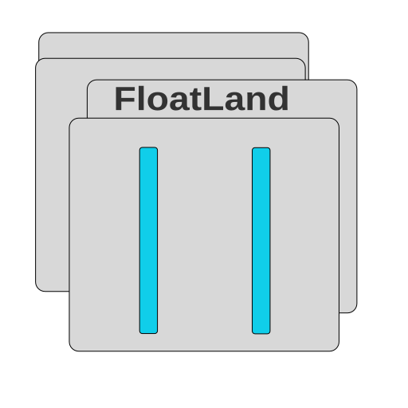

<p align="center">
  
</p>

<h1 align="center">FloatLand</h1>

[English](README.md) · **Русский**

# Floatland 0.6.1.1

> **Дисклеймер:** Этот проект был написан при помощи ии.

Floating/tiling, нативные заголовки, snap, Alt+Tab и обзор окон для Hyprland 0.56.2.
Один проект, один запуск. Версия 0.5.92 переведена в обычную ветку по результатам
пользовательского тестирования. 0.6.0 продолжает её с новой структурой и Lua-настройками;
экспериментальные возможности по умолчанию отсутствуют.

- **Вы можете найти видео с функцианалом в папке "examples"**

## Исправление 0.6.1.1

Подсветка и выполнение действия требуют попадания в круг кнопки. Пространство
между кругами больше не активирует кнопку. Круг активации сохраняет исходный радиус
7 логических px во время деформации, чтобы анимация не меняла условия клика.

Этот патч не объявляет проблему Lua решённой: присланный журнал показывает одинаковые
настройки и отсутствие замеченных изменений файлов. Активный путь выводится при запуске.

## Изменения 0.6.1

Lua автоматически перечитывается после сохранения (обычно через 0.5–1 секунду).
`python3 run.py reload` остаётся для ручного применения. В терминале выводятся
активный путь и `Config applied` с подтверждением от нативного плагина. Ошибки
конфига оставляют прежние значения. Редактируй файлы в `~/.config/floatland/`,
а не шаблоны в папке исходников.

Titlebar: сторона и порядок кнопок, выравнивание/скрытие названия, отдельное
отключение значков, бликов и эффектов. Действие выполняется при отпускании внутри
исходной кнопки независимо от времени удержания. Уход снимает подсветку, возвращение
восстанавливает её. Отпускание вне кнопки отменяет действие. Добавлены подгонка
штрихов значков к масштабу дисплея и более выраженный одиночный возвратный отскок.

Существующие Lua-файлы не заменяются. Новые настройки с пояснениями:

```sh
python3 run.py config reference
```

Для нового характера движения в своём `config/titlebars.lua` измени старые значения:

```lua
button_shift = 0.9,
button_stretch = 1.5,
return_duration = 0.28,
rebound = 0.12,
```

Если меняешь `theme.lua`, но компонент имеет собственный `color`, он имеет приоритет;
теперь об этом выводится предупреждение. Убери локальный цвет, чтобы использовать
общую тему. Новая миграция JSON больше не создаёт такие дублирующие цвета.

`run.py` показывает WARNING/ERROR Python, сообщения диагностики плагина и результат
reload. Журнал `logs/session.log` сохраняется между запусками и ротируется
(до 2 MiB на файл, два резервных файла). Аварии самого композитора всё ещё могут
потребовать crash-report. Переработка overview/Alt+Tab и память размеров приложений
после закрытия в этот выпуск не входят.

## Запуск и обновление

Останови предыдущий запуск через Ctrl+C или `python3 run.py stop`, дождись завершения
и распакуй новый архив в отдельную папку. В ней выполни:

```sh
python3 run.py
```

Сборка, загрузка плагина и запуск демона автоматические. Терминал оставь открытым.
Журнал: `logs/session.log`. Нужны Python 3.9+, CMake 3.22+, C++23, pkg-config,
заголовки именно установленного Hyprland 0.56.2, pixman, libdrm, libinput, libudev,
wayland-server, xkbcommon, pangocairo и librsvg. Новая зависимость для настроек:
интерпретатор **Lua** (`lua`, `lua5.4`, `lua5.3` или `luajit`); альтернативно Python `lupa`.
Версия и ABI заголовков проверяются до сборки. Внешний overview-плагин не требуется.

Можно запускать из любой папки: `python3 /полный/путь/floatland/run.py`.
Конфиг Hyprland автоматически не переписывается. Пример ручного подключения:
[examples/hyprland.lua](examples/hyprland.lua). Сборка из этого архива — основной
способ запуска; установка одного Python wheel не устанавливает нативный плагин.

## Настройки Lua

При первом запуске создаётся структура (учитывается `$XDG_CONFIG_HOME`):

```text
~/.config/floatland/
├── init.lua
└── config/
    ├── windows.lua       # режим, размеры, отступы, исключения
    ├── titlebars.lua     # цвет, прозрачность, кнопки, растяжение
    ├── snapping.lua      # snap-area и её анимация
    ├── overview.lua      # blur, фон, переходы
    ├── switching.lua     # Alt+Tab, шрифт, иконки, переходы
    ├── bindings.lua      # клавиши Alt+Tab и Super+G
    ├── theme.lua         # общие цвета
    └── experimental.lua  # пока пустой резерв
```

Существующий `config.json` автоматически переносится в Lua и остаётся на диске.
Существующие Lua-файлы не перезаписываются. После появления `init.lua` настройки
читаются из Lua; правки старого JSON уже не влияют на запуск.

```sh
python3 run.py config init   # создать/перенести настройки без запуска Hyprland
python3 run.py config path   # путь к init.lua
python3 run.py config show   # проверить и показать итоговые значения
python3 run.py reload        # применить к работающему единому запуску
```

Например, в `config/titlebars.lua` можно изменить `opacity = 0.9`,
`button_shift = 0.5`, `rebound = 0.04`. Все файлы возвращают Lua-таблицу.
Цвета — `"#RRGGBB"`. Общие цвета в `theme.lua`, значения конкретного компонента
имеют приоритет. Полный справочник: [docs/configuration.md](docs/configuration.md).

Reload сначала читает и проверяет всю конфигурацию. При ошибке настройки остаются
прежними. Успешная перезагрузка закрывает активный переключатель/overview и применяет
настройки; сохранённая геометрия и список свёрнутых окон остаются. Изменения окон
применяются последовательными командами, а не одной транзакцией композитора.

## Управление

- Alt+Tab — выбор окна текущего рабочего стола; отпустить Alt — выбрать, Esc — отменить.
- Super+G — обзор окон текущего рабочего стола на мониторе под курсором.
- В обзоре: клик/Enter — выбрать, стрелки/колесо — сменить выбор, Esc/Super+G — закрыть.
- Перетащи заголовок к краю или в верхнюю палитру для snap.
- `python3 run.py toggle` — floating/tiling; `snap left`, `maximize`, `restore`, `center`, `minimize`, `restore-minimized`, `pin` — команды окон.

Alt+Tab включает закреплённые окна и свёрнутые Floatland с текущего стола.
Кнопки заголовка: закрыть, свернуть, развернуть. Отпускание вне исходной кнопки
отменяет действие; возвращение на неё перед отпусканием разрешает действие. Настройки эффектов
не меняют область клика. Отступы snap учитывают зарезервированное панелями место.

Overview использует снимки и поэтапную подготовку сцены с разворотом перехода при
повторном нажатии. Свёрнутые окна остаются свёрнутыми до выбора. Последний снимок
хранится в памяти плагина: после его перезапуска ранее свёрнутое окно нужно один раз
восстановить и свернуть снова. При недоступном снимке, повёрнутом мониторе или
исчерпании бюджета 48 миллионов пикселей остаётся иконка. Это не live-камера окон.

Известно: Alt+Shift+Tab (переключение назад) пока **не работает**.

## Исходники и проверка

```text
run.py                 единая точка запуска
src/floatland/         Python: политика окон, IPC, сессия, конфигурация
src/floatland/defaults/ поставляемые шаблоны Lua
native/                C++: декорации, ввод, snap, переключатель, overview
examples/              примеры интеграции и прежний JSON
tests/                регрессионные проверки
tools/check.py        запуск Python/Lua и независимых C++ тестов
docs/                 архитектура, настройки, история проверок
```

```sh
python3 tools/check.py
```

Для Lua-тестов установи Python `lupa`; для C++-тестов нужен компилятор.
Проверка логики не заменяет сборку полного плагина и работу на Linux.
0.6.1 проверена 186 тестами Python/Lua и независимыми C++-тестами на macOS; графические изменения настроек
ещё требуют проверки на Hyprland. Двухдневный нагрузочный тест не проводился.

Высота нативного заголовка пока фиксирована: 32 логических px. Отдельная маска
нижних углов приложения пока не реализована. Документы старых аудитов и экспериментов
сохранены как история, их ограничения и номера тестов относятся к указанным версиям.

## Стабильная 0.6.7

Перенос проверенного поведения 0.6.7e: оконный PiP, настройка диаметра кнопок, обновлённая упругость, защита памяти размеров XWayland и накопленные улучшения переключателя/обзора окон. ПКМ по тайтлбару или `python3 run.py pip` переключает нынешний PiP. В `~/.config/floatland/config/titlebars.lua` можно добавить `button_size = 14,` (8–20 логических пикселей).

Клиентские декорации Qt остаются отдельным необязательным экспериментом. Новое контекстное меню и выдвигаемая капсула запланированы отдельно в [0.6.8e](docs/experiment-0.6.8e.md).
